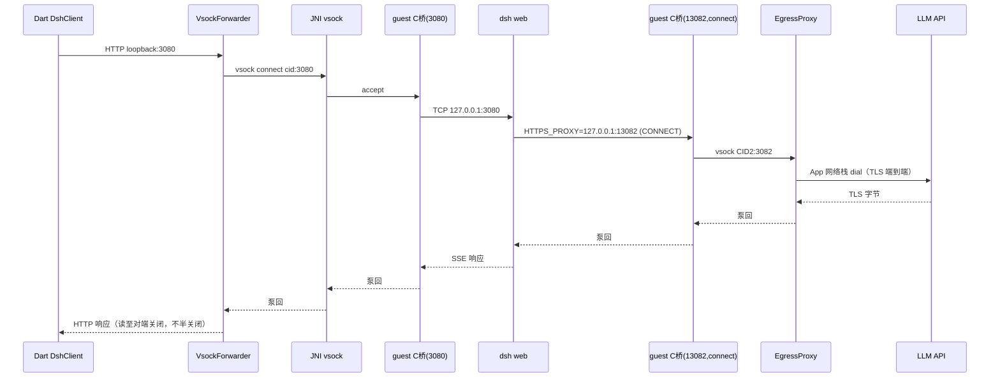

# dsh-Go PRoot → AVF 虚拟化改造 概要设计说明书（HLD）

- 文档编号：DSHGO-AVF-HLD-001
- 版本：1.0（2026-11-24）
- 关联：[需求规格](avf-srs.md) · [详细设计](avf-lld.md) · [测试报告](avf-test-report.md) · [探索记录](avf-backend.md)

## 1. 设计目标与原则

把 DSH 引擎从 PRoot（ptrace 用户态模拟）搬进 AVF 真 Linux 虚拟机，同时：

1. **上层零改动**：Dart `DshClient` 仍对话 loopback HTTP；Riverpod/UI/手机
   操控安全门契约不变。改造被封装在 Kotlin 运行时层与 guest 镜像内。
2. **技术路线以真机实证为准**：目标设备（麒麟定制 Android 16）的 AVF 行为
   与 AOSP 文档有出入，所有关键决策都由设备实验定论（见 §3），不靠推测。
3. **最小必要**：不引入多余抽象/状态机；失败要么可恢复（重试/回退），
   要么明确报错；PRoot 保留为默认与回退。

## 2. 总体架构

### 2.1 分层

```
┌────────────────────────────────────────────────────────────┐
│ Flutter UI / Riverpod / DshClient（纯 Dart）—— 零改动        │
├────────────────────────────────────────────────────────────┤
│ RuntimeController（Kotlin）—— 契约不变，新增 AVF 分支         │
│   ├─ DshProcess（PRoot，默认/回退）                          │
│   └─ AvfProcess（AVF，可选开关）                             │
│        ├─ AvfVm      VM 进程（vm run / requester kill）      │
│        ├─ AvfImage   镜像安装/校验/版本                      │
│        ├─ VmCtl      控制通道客户端（status/save/restore）    │
│        ├─ VsockForwarder  loopback:3080 → vsock cid:3080     │
│        ├─ EgressProxy     vsock:3082 accept → App 网络栈     │
│        └─ Vsock/JNI       AF_VSOCK 原语（libvsock_client.so）│
│   PhoneControl/PhoneBridge + PhoneVsockListener（vsock:3083）│
├────────────────────────────────────────────────────────────┤
│ AVF VM（crosvm + microdroid_kernel，独立内核）               │
│   init（busybox PID1）→ 4×vsock-tcp-bridge + vm-ctl + dsh web│
│   只读 ext4 rootfs（Ubuntu24.04 + Node24 + 补丁DSH + 桥）     │
│   可写状态全在 tmpfs，经 vm-ctl 由 host 持久化                │
└────────────────────────────────────────────────────────────┘
```

### 2.2 四条 vsock 通道（端口布局）

| vsock 端口 | 方向 | guest 端 | host 端 | 用途 |
|---|---|---|---|---|
| 3080 | host→guest | C 桥 listen → TCP 127.0.0.1:3080（dsh web） | VsockForwarder（loopback:3080 accept → vsock connect） | HTTP/SSE 引擎 API |
| 3081 | host→guest | C 桥 listen → TCP 127.0.0.1:13081（vm-ctl.mjs） | VmCtl（vsock connect） | status/token、save/restore |
| 3082 | guest→host | C 桥 **connect**（TCP 13082 accept → vsock CID2:3082） | EgressProxy（vsock:3082 listen/accept → App dial） | guest 出网代理 |
| 3083 | guest→host | C 桥 **connect**（TCP 13083 accept → vsock CID2:3083） | PhoneVsockListener（vsock:3083 accept → PhoneBridge TCP） | 手机操控回路 |

**方向决定桥模式**：host 主动连 guest 用 listen 模式（guest 守 vsock）；
guest 主动连 host 用 connect 模式（guest 守 loopback TCP，dial host CID 2）。
guest 侧 Node 无 AF_VSOCK（§3 决策 D4），所以 guest→host 必须由 C 桥承担。

### 2.3 数据流（一次聊天请求）



## 3. 技术路线决策（真机实证定论）

> 本节是概要设计的核心：每条路线选择都给出「备选 → 实验 → 定论」。
> 详细实验数据见 [探索记录](avf-backend.md) 与 [测试报告](avf-test-report.md)。

### D1 虚拟化底座：AVF custom VM（crosvm）✅

- **备选**：① 继续 PRoot；② Microdroid + payload；③ AVF custom VM。
- **实验**：设备 pKVM protected/non-protected 均支持，/dev/kvm 0666，
  crosvm/virtmgr/vm 工具齐全；shell `vm run` 可启动自定义内核+rootfs。
- **定论**：选 ③。真 Linux 内核，无 ptrace 开销，内核级隔离。Microdroid
  payload 作为量产权限受限时的备选（未实施）。
- **代价**：custom VM 权限门槛（D5）、无 virtio-net（D2）、磁盘只读（D3）。

### D2 网络：vsock 代理，放弃 TAP ❌→✅

- **备选**：① virtio-net/TAP；② vsock + host 代理。
- **实验**：`--network-supported` 不产生 TAP（virtmgr 对 custom VM 静默
  忽略）；guest 内核 virtio_net 未内建（字符串 0 命中）；vsock 端到端
  HTTP 200 OK 验证通过。
- **定论**：选 ②。guest 出网 = guest loopback 代理 → C 桥 connect →
  vsock 3082 → App EgressProxy → App 网络栈。TLS 端到端，App 只转字节。
- **关键**：App 用自身网络栈 dial，继承 App 的网络权限/代理/证书，guest
  无需任何网络配置。

### D3 存储：只读 rootfs + tmpfs + 控制通道持久化 ✅

- **备选**：① 可写 virtio-blk 数据盘；② 9p 文件共享；③ 只读 root + tmpfs +
  vsock save/restore。
- **实验**：`writable:true` 时 guest 写 superblock EBADF——根因是 **virtmgr
  打开磁盘 fd 恒 O_RDONLY**（/proc/<crosvm>/fd 证实），非内核/crosvm 问题；
  9p 驱动未 probe。
- **定论**：选 ③。rootfs 只读直启（`root=/dev/vda1 ro init=/init`）；
  DSH_HOME/phone 配置在 tmpfs；App 停机前 `save`、启动后 `restore`。
- **推论**：guest 内核无 devtmpfs → init 用 tmpfs+mknod 建 /dev；ro 根上
  挂载点目录必须镜像预建（否则 mount ENOENT 误导）。

### D4 guest→host 传输：C 桥 connect 模式，不用 Node vsock ✅

- **备选**：① guest Node 直接 AF_VSOCK；② 静态 C 桥。
- **实验**：Node 24 `net.connect({family:42})` → ERR_INVALID_ARG_VALUE
  （真机定论，Node 不支持 vsock family）。
- **定论**：选 ②。`vsock-tcp-bridge -c <tcpPort> <vsockPort>`：守 guest
  loopback TCP，accept 后 dial vsock CID_HOST(2):vsockPort。egress/phone
  两条 guest→host 通道都用它。host→guest 方向用同桥的 listen 模式。
- **桥的半关闭修复**：旧桥任一方向 EOF 即双向 SHUT_RDWR+close，竞态掐断
  响应；新桥每方向独立 pump，EOF 只 shutdown 对端 SHUT_WR，最后完成者
  close 双 fd（见详细设计 §4）。

### D5 权限与 VM 控制：shell vm 工具 + stdout 解析 CID ✅

- **备选**：① VirtualMachineManager 公开 API；② shell `vm` 工具。
- **实验**：aconfig custom_vm flags disabled → 公开 API 被挡；
  createVm 查 **MANAGE_VIRTUAL_MACHINE + USE_CUSTOM_VIRTUAL_MACHINE**
  （development 级，manifest 声明后 `pm grant` 可授）；`vm list` 需
  signature 级 DEBUG_VIRTUAL_MACHINE（App 拿不到）；`vm run` stdout 首行
  `Created VM from "…" with CID N`；杀 `vm run` 进程（requester）→ virtmgr
  teardown guest。
- **定论**：选 ②。AvfVm 用 ProcessBuilder 跑 `vm run`，正则解析 CID，
  stop=destroy 自身进程。**不依赖 vm list / DEBUG 权限**。
- **vsock 设备**：App uid 的 AF_VSOCK socket+connect 在 /dev/vsock 0600 下
  成功（麒麟内核放宽），JNI 只 socket+connect，**无需 chmod 任何设备节点**。

### D6 host 侧 vsock：JNI 原生库 ✅

- **备选**：① Java/Kotlin 原生 socket；② JNI。
- **实验**：JVM 无 AF_VSOCK family。
- **定论**：选 ②。`libvsock_client.so` 暴露 connect/read/write/close/
  listen/accept；Kotlin 包成流。包名 `dsh_app` → C 符号 `dsh_1app`；
  internal external 用 `@JvmName` 固定 JVM 名（否则 Kotlin 加模块后缀）。

### D7 传输契约：禁止半关闭 ✅（内核缺陷规避）

- **实验**：客户端发完请求 `shutdown(SHUT_WR)` → guest 内核 vsock 丢在途
  数据（小响应竞态、43KB 大响应 0/20 稳定丢失）；不半关闭全通道 20/20。
- **定论**：**host 侧客户端发完请求不得 SHUT_WR，读响应到对端关闭**。
  guest 两个服务端（HTTP/1.0、vm-ctl sock.end）响应后自关，无需半关闭。
  契约写入 vm-manifest.json `vsock.transportContract`，所有 host 客户端遵守。

### D8 手机回路：vsock 隧道进既有 PhoneBridge，安全门不动 ✅

- **备选**：① abstract unix socket 跨 VM；② vsock 隧道。
- **实验**：abstract socket 跨不了 VM 边界。
- **定论**：选 ②。guest relay → C 桥 13083 → vsock 3083 → App
  PhoneVsockListener → PhoneBridge loopback TCP。hello token/NDJSON/
  SafetyGate/审批全部留在 App，语义零改动；AVF 保持「本机」语义。

### D9 镜像构建：fakeroot + mkfs.ext4 -d，可复现 ✅

- **备选**：① root/loop 挂载填充；② fakeroot tar 解包 + mkfs.ext4 -d。
- **实验**：`mkfs.ext4 -d <dir>` 无需 root/loop 直接填充；fakeroot 保持
  uid/gid 0 与 mode。
- **定论**：选 ②。runtimeVersion 由全部输入 SHA-256 派生（可复现）；
  补丁链与 PRoot 共用；phone 静态文件从 PhoneGuest.kt 常量提取（唯一源）。

## 4. 模块划分与职责

| 模块 | 文件 | 职责 | 对应需求 |
|---|---|---|---|
| AvfImage | runtime/avf/AvfImage.kt | 镜像安装/SHA校验/原子换入/版本/重置 | FR-IMG |
| AvfVm | runtime/avf/AvfVm.kt | vm run 进程、CID 解析、requester stop、supported() | FR-BOOT/FR-LIFE |
| AvfProcess | runtime/avf/AvfProcess.kt | 启动编排、就绪判定、save/restore、exit-watch、转发/egress 装配 | FR-BOOT/FR-STATE/FR-LIFE |
| Vsock/JNI | runtime/avf/Vsock.kt + cpp/vsock_client.c | AF_VSOCK 六原语 + 流包装 | FR-TRANS |
| VsockForwarder | runtime/avf/VsockForwarder.kt | loopback:3080 → vsock cid:3080 | FR-TRANS/IF-2 |
| VmCtl | runtime/avf/VmCtl.kt | status/save/restore 客户端 | FR-STATE/IF-3 |
| EgressProxy | runtime/avf/EgressProxy.kt | vsock:3082 accept → CONNECT/absolute-form → App dial | FR-NET |
| PhoneVsockListener | phone/PhoneVsockListener.kt | vsock:3083 accept → PhoneBridge TCP | FR-PHONE |
| PhoneControl/PhoneGuest | phone/*.kt | prepareAvfLaunch、bridge.json 下发、relay 常量 | FR-PHONE |
| RuntimeController | runtime/RuntimeController.kt | AVF 开关/互斥/失败标记/回退、status 契约 | FR-LIFE/IF-1 |
| guest init | runtime/vm/init | PID1 挂载/桥/监管 | FR-BOOT |
| vsock-tcp-bridge | runtime/vm/vsock-tcp-bridge.c | listen/connect 双模式桥 | FR-TRANS |
| vm-ctl.mjs | runtime/vm/vm-ctl.mjs | token 上报、save/restore 服务端 | FR-STATE |
| build-vm-image.sh | runtime/build-vm-image.sh | 镜像流水线 | FR-IMG |

## 5. 关键流程（概要）

### 5.1 启动

```
RuntimeController.startProcess(useAvf)
  → PhoneControl.prepareAvfLaunch（起 PhoneBridge TCP+vsock，得 bridge.json）
  → AvfProcess.start
      → AvfVm.start（vm run，解析 CID）
      → exit-watch 线程（vm.start 之后才 arm）
      → awaitCid(30s) → awaitReady(180s, vm-ctl status)
      → restoreState（DSH_HOME 快照 + @phone/bridge.json）
      → startEgress（vsock:3082）
      → forwardHttp（loopback:3080 → vsock cid:3080）→ canConnect 探活
      → onReady(baseUrl, token) → Dart 层
```

### 5.2 停止与持久化

```
AvfProcess.stop → saveState（vm-ctl save → prefs）→ cleanupForwarder/egress
  → AvfVm.stop（destroy requester → virtmgr teardown guest）
```

### 5.3 失败与回退

```
exit-watch 检测 VM 意外退出 → onExit(code)
  → RuntimeController：K_AVF_FAILED 标记 → 失败卡 + 重试
  → 重试成功恢复 RUNNING；连续失败按 strikes/安全模式回退 PRoot
```

## 6. 安全设计（概要）

- **隔离边界**：引擎在独立内核/地址空间，不能直接读 App 私有目录。
- **安全裁决不下放**：SafetyGate/审批/任务结算全在 App；guest 被攻破也
  不能绕过审批操控手机（phone 回路只是字节隧道，裁决在 App 端 TCP 之后）。
- **凭据**：只进 guest tmpfs(0700) 与 App 受控 prefs；不进镜像/日志/诊断明文。
- **egress**：不解密 TLS；上游失败回 502 稳定错误。
- **restore 校验**：拒绝对路径/..、@phone 白名单、≤64MB、mode 0600。

## 7. 兼容与回退

- Dart/bridge 协议零改动（baseUrl 仍 loopback，Host 头保持 127.0.0.1:3080）。
- PRoot 默认且完整可用；AVF 开关默认关、与 direct/tawc 互斥、要求停止态。
- 设备不支持（无 vm 工具/内核/权限）→ 开关不可用 + 中英文案说明原因。
- 插件：VM 内无 pnpm，安装走 App 下载→校验→restore 下发→重启引擎（后续）。

## 8. 风险与缓解

| 风险 | 缓解 |
|---|---|
| 量产设备权限不放行 | 开关优雅不可用；备选 Microdroid payload（未实施） |
| guest 内核 vsock 半关闭缺陷 | 传输契约禁半关闭（D7），不修内核 |
| 镜像 748MiB 偏大 | 裁剪另行评估；首期功能优先 |
| 厂商 AVF 行为差异 | 全部决策真机实证；supported() 门禁 + PRoot 回退 |
| VM 内存压力 | 512MiB 配额；实测 RSS ~392MB 留余量 |