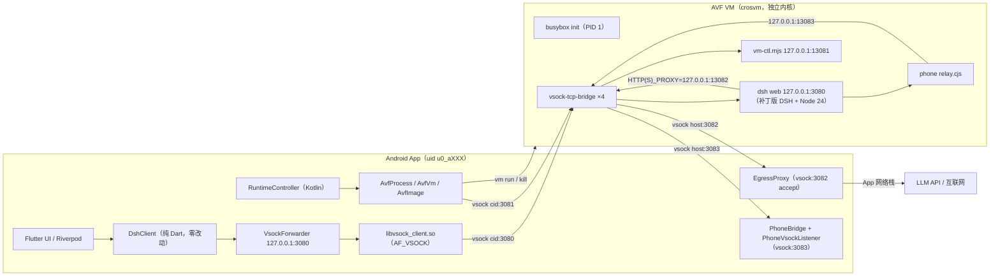

# dsh-Go PRoot → AVF 虚拟化改造 需求规格说明书（SRS）

- 文档编号：DSHGO-AVF-SRS-001
- 版本：1.0（2026-11-24）
- 状态：已实现并真机验收（对应分支 `feat/avf-backend`）
- 关联文档：[概要设计](avf-hld.md) · [详细设计](avf-lld.md) · [测试报告](avf-test-report.md) · [前期探索记录](avf-backend.md)

## 1. 引言

### 1.1 背景

dsh-Go 是 DeepSeek Harness（DSH）的 Android 手机客户端。现有本机引擎方案把
打过补丁的 DSH（Node.js 程序）放进一个 Ubuntu rootfs，用 **PRoot**（ptrace
用户态系统调用翻译）在 App 进程内模拟 Linux 环境运行 `dsh web`。PRoot 路线
存在固有缺陷：

1. **性能开销**：每个系统调用经 ptrace 往返两次上下文切换，I/O 密集与
   进程密集负载（DSH 的 shell 工具、插件安装）显著变慢；
2. **兼容性缺口**：ptrace 翻译不完整（部分 ioctl、clone 语义、/proc 视图），
   引擎行为与真实 Linux 有偏差；
3. **隔离性弱**：引擎与 App 同 uid 同进程树，引擎内任意代码可直接读写 App
   私有数据（凭据、会话），无内核级边界；
4. **稳定性**：PRoot 自身崩溃或被系统查杀会连带整个引擎，且受 Android
   后台进程管控（ phantom process killer）影响。

目标设备（长城 pd2508，麒麟定制 Android 16）具备 **AVF（Android
Virtualization Framework）** 能力：pKVM、crosvm、virt APEX 齐全，且厂商
（麒麟）对 vsock/权限做了放宽。这为「把引擎搬进真 Linux 虚拟机」提供了
硬件虚拟化基础。

### 1.2 目标

在**不改变 App 上层契约**（Dart `DshClient`、Riverpod 状态、UI、手机操控
安全门）的前提下，新增一个 **AVF 后端**：DSH 引擎运行在 AVF 虚拟机内的
极简 Ubuntu rootfs 中，App 通过 vsock 与 VM 通信。PRoot 路线保留为回退。

### 1.3 范围

- **In scope**：VM 镜像构建流水线、guest init/控制通道、App 侧 VM 生命周期
  管理、vsock 传输层（JNI）、HTTP 转发、guest 出网代理、手机操控回路
  vsock 化、状态持久化（save/restore）、失败回退与 UI 契约、真机验证。
- **Out of scope**：Microdroid payload 路线（备选，未实施）；VM 内插件市场
  安装（pnpm 不进镜像，走 App 下发，见概要设计 §7）；x86_64/其他 ABI；
  量产签名设备的权限放行（依赖厂商，见 §6 约束）。

### 1.4 术语

| 术语 | 含义 |
|---|---|
| AVF | Android Virtualization Framework（VirtualizationService/virtmgr/crosvm） |
| pKVM | protected KVM，Android 的内核级虚拟化底座 |
| crosvm | AVF 的 VMM（虚拟机监视器）进程 |
| vsock | virtio-vsock，host↔guest 的 socket 通道（AF_VSOCK=40），按 CID+port 寻址 |
| CID | Context ID：host=2，guest 由 virtmgr 分配（实测 2052 起） |
| vm-ctl | 本项目自定义的 guest 控制通道（status/save/restore） |
| DSH_HOME | DSH 的状态目录（/root/.dsh，凭据/设置/会话索引） |
| PRoot | 现有 ptrace 用户态 Linux 模拟路线（回退后端） |
| egress | guest 出网（LLM API 等外部 HTTPS） |
| phone 回路 | 引擎 `mcp__phone__*` 工具 → App 手机操控桥 |

## 2. 总体描述

### 2.1 系统上下文（改造后）

### 2.2 用户与使用场景

- **最终用户**：在支持 AVF 的设备上开启「虚拟机引擎」开关，获得与 PRoot
  版完全一致的聊天/会话/手机操控体验；引擎崩溃不影响 App，可一键重试。
- **开发者**：`build-vm-image.sh` 一条命令产出可启动镜像；`vm run` 可脱离
  App 独立调试 guest。
- **运维/诊断**：VM 串口控制台落盘 `vm-console.log`，App 侧日志统一进
  `files/runtime/logs/dsh.log`，诊断包可携带。

### 2.3 运行环境约束（真机实测定论）

| 约束 | 实测结论 | 对需求的影响 |
|---|---|---|
| C1 无 virtio-net | custom VM 不产生 TAP/virtio-net 设备（virtmgr 静默忽略 `--network-supported`） | guest 出网必须经 host 代理（FR-NET） |
| C2 磁盘只读 | virtmgr 打开磁盘 fd 恒 O_RDONLY，`writable:true` 也写不进（EBADF） | rootfs 只读；持久化走控制通道（FR-STATE） |
| C3 guest 内核怪癖 | microdroid_kernel 6.6.98：无 devtmpfs、无 9p、vsock 半关闭丢数据 | init 用 tmpfs+mknod；传输契约禁半关闭（FR-TRANS） |
| C4 Node 无 AF_VSOCK | Node 24 `net.connect({family:42})` → ERR_INVALID_ARG_VALUE | guest→host 方向必须 C 桥（FR-TRANS） |
| C5 权限门槛 | createVm 查 MANAGE_VIRTUAL_MACHINE + USE_CUSTOM_VIRTUAL_MACHINE（development 级，可 `pm grant`）；`vm list` 需 signature 级 DEBUG 权限拿不到 | CID 从 `vm run` stdout 解析；停止=杀自身 requester 进程（FR-LIFE） |
| C6 公开 API 被挡 | aconfig custom_vm flags disabled，VirtualMachineManager 公开 API 不可用 | 走 shell `vm` 工具（/apex/com.android.virt/bin/vm） |
| C7 Java 无 vsock | JVM/Android 无 AF_VSOCK socket | JNI 原生库（FR-TRANS） |

### 2.4 假设与依赖

- 设备厂商放行 development 级 VM 权限（本目标设备已验证可 `pm grant`）；
  量产设备需厂商预授或签名放行，否则 AVF 开关不可用（UI 显示不可用文案）。
- guest 内核来自设备 virt APEX（microdroid_kernel），不随 APK 分发。
- DSH 补丁链与 PRoot 版共用（`runtime/patches/` + pins），版本钉死。

## 3. 功能需求

### FR-IMG 镜像构建与安装

- FR-IMG-1：一条命令（`runtime/build-vm-image.sh`）从钉死的 Ubuntu Base
  24.04.5 + Node 24.22.1 + 补丁 DSH + dsh-go-bridge 产出只读 ext4 rootfs、
  `vm-config.json`、`vm-manifest.json`（含 SHA-256、vsock 端口表、传输契约）。
- FR-IMG-2：镜像不含 pnpm/Python/git（裁剪）；含 busybox-static（init）、
  静态 aarch64 vsock-tcp-bridge、vm-ctl.mjs、phone relay/overlay 静态文件。
- FR-IMG-3：`runtimeVersion` 由全部输入（base/node/debs/补丁/桥/init/桥源码/
  PhoneGuest.kt）SHA-256 派生，输入不变则版本不变（可复现）。
- FR-IMG-4：App 安装镜像时校验 SHA-256，staging 四文件原子换入；半写状态
  不得被视为已安装。安装进度可上报 UI。
- FR-IMG-5：镜像版本与 APK 内置版本不一致时提示更新；重置可整体删除。

### FR-BOOT 启动与就绪

- FR-BOOT-1：`root=/dev/vda1 ro rootwait init=/init` 直启，免 initramfs；
  显式 `init=/init`（该内核 root= 模式不试 /init）。
- FR-BOOT-2：guest init 完成 proc/sys/tmpfs 挂载、lo up、4 个 vsock 桥、
  vm-ctl、dsh web 监管循环（崩溃 2s 重启）。
- FR-BOOT-3：App 从 `vm run` stdout 解析 CID（30s 超时）；经 vm-ctl 轮询
  `status.ready && token`（180s 超时）判定就绪。
- FR-BOOT-4：就绪后 App 建立 loopback→vsock HTTP 转发并探活（HTTP 200..499），
  然后才向 Dart 层报 `onReady(baseUrl, token)`。

### FR-TRANS vsock 传输

- FR-TRANS-1：JNI 提供 connect/read/write/close/**listen/accept** 六个原语；
  Kotlin 包装成流（InputStream/OutputStream），上层按 TCP 语义泵字节。
- FR-TRANS-2：**传输契约**：客户端发完请求后不得 `shutdown(SHUT_WR)`，
  读响应直到对端关闭（guest 内核半关闭丢在途数据，真机定论）。契约写入
  vm-manifest.json，所有 host 侧客户端/转发器遵守。
- FR-TRANS-3：guest→host 方向（egress/phone）由 C 桥 connect 模式承担
  （guest loopback TCP → vsock CID 2:port），不依赖 Node vsock。
- FR-TRANS-4：host→guest 方向（web/ctl）由 C 桥 listen 模式承担
  （vsock:port → guest loopback TCP）。

### FR-NET guest 出网

- FR-NET-1：guest 内 `HTTP(S)_PROXY=http://127.0.0.1:13082` +
  `NODE_USE_ENV_PROXY=1`，DSH 的 LLM/HTTP 流量全部走代理。
- FR-NET-2：App 侧 EgressProxy 在 vsock:3082 accept，解析 CONNECT /
  absolute-form，用 **App 自身网络栈** dial 真实目标；TLS 端到端不变
  （App 只转字节，不解密）。
- FR-NET-3：loopback 目标（127.0.0.1/localhost）在 guest 内直连，不出 VM。
- FR-NET-4：上游不可达时返回稳定错误（502），不静默吞。

### FR-STATE 状态持久化

- FR-STATE-1：DSH_HOME 位于 guest tmpfs（0700）；VM 停止前 App 经 vm-ctl
  `save` 取回全部常规文件（base64），存 App prefs；下次启动 `restore` 写回。
- FR-STATE-2：restore 拒绝绝对路径/`..`，总量 ≤64MB，文件 mode 0600；
  `@phone/bridge.json` 白名单进独立 tmpfs，**不参与 save**（每次启动下发）。
- FR-STATE-3：restore 失败不删快照（下次可重试）；save 失败不阻塞停机。
- FR-STATE-4：登录态（cookie/token）跨 VM 重启的语义与 PRoot 一致：
  token/cookie 绑定 authority，VM 重启后需重新 status+login（DSH 行为，
  不改引擎）；DSH_HOME 内的凭据/设置经 save/restore 保留。

### FR-LIFE 生命周期与回退

- FR-LIFE-1：AvfProcess 对 RuntimeController 暴露与 DshProcess 相同的契约
  （start/stop/onReady/onExit/startupError），strikes/安全模式/LKG 语义不变。
- FR-LIFE-2：VM 意外死亡（exit-watch）→ 失败计数 → 失败卡 + 重试；重试
  成功恢复 RUNNING；连续失败按既有安全模式回退 PRoot。
- FR-LIFE-3：停止 = 杀 App 自己 spawn 的 `vm run` 进程（它是 requester，
  virtmgr 随之 teardown guest）；不依赖 `vm list`。
- FR-LIFE-4：AVF 开关默认关；与 direct/tawc 互斥；要求停止态才能切换；
  开启时清除历史失败标记。设备不支持时开关不可用并显示原因文案（中英）。

### FR-PHONE 手机操控回路

- FR-PHONE-1：guest relay 经 C 桥（13083→vsock 3083）到 App
  PhoneVsockListener，再泵进既有 PhoneBridge loopback TCP。
- FR-PHONE-2：hello token 常数时间比较、NDJSON JSON-RPC、SafetyGate/审批/
  任务所有者结算**全部留在 App 端，语义零改动**。
- FR-PHONE-3：`android_shell`、无障碍/Shizuku/ADB 执行路径零改动；AVF 模式
  保持「本机」语义，不解除 remoteHost 门禁。
- FR-PHONE-4：bridge.json 每次启动经 vm-ctl restore 下发；relay/overlay
  静态文件构建期预置进镜像（PhoneGuest.kt 常量为唯一源）。

### FR-OBS 可观测性

- FR-OBS-1：guest 串口控制台落盘 `files/runtime-avf/vm-console.log`；
  App 侧 AVF 日志统一进 `files/runtime/logs/dsh.log`（`[dsh-app]`/`[vm]` 前缀）。
- FR-OBS-2：诊断包可携带上述日志；凭据不落日志（token 仅内存与受控 prefs）。

## 4. 非功能需求

### NFR-PERF 性能

- NFR-PERF-1：冷启动（VM up→dsh web ready）≤ 15s（目标；实测 ~7.1s）。
- NFR-PERF-2：控制通道单次往返 ≤ 50ms（实测 ~10ms）。
- NFR-PERF-3：HTTP 转发对 43KB 页面的附加时延 ≤ 50ms（实测 ~14ms）。
- NFR-PERF-4：VM 内存配额 512 MiB；guest 实际 RSS 不超配额（实测 ~392MB）。
- NFR-PERF-5：聊天端到端体验不劣于 PRoot（真实模型对话 + guest shell 工具
  执行可用，无超时/断流）。

### NFR-SEC 安全与隐私

- NFR-SEC-1：引擎与 App 内核级隔离（独立内核/地址空间）；引擎内代码不能
  直接读 App 私有目录。
- NFR-SEC-2：手机操控安全裁决（SafetyGate/审批）不进入 guest；guest 被
  攻破也不能绕过审批直接操控手机。
- NFR-SEC-3：egress 代理不解密 TLS；App 不记录完整 API key/token。
- NFR-SEC-4：vm-ctl restore 路径校验（拒绝对路径/..、白名单、大小上限）。
- NFR-SEC-5：凭据只进 guest tmpfs（0700）与 App 受控 prefs，不进镜像、
  不进日志、不进诊断包明文。

### NFR-REL 可靠性

- NFR-REL-1：dsh web 崩溃由 guest 监管循环 2s 重启，VM 不重启。
- NFR-REL-2：VM 死亡 App 可感知（exit-watch）并走失败卡/重试/回退，不卡死。
- NFR-REL-3：save/restore 幂等、失败可重试；半写安装不可见。

### NFR-COMP 兼容与可维护

- NFR-COMP-1：Dart `DshClient`、`packages/dsh_client`、bridge 协议零改动
  （baseUrl 仍是 loopback）。
- NFR-COMP-2：PRoot 路线保持默认与完整可用；AVF 为可选开关。
- NFR-COMP-3：补丁链/版本钉死与 PRoot 共用；镜像可复现构建。
- NFR-COMP-4：界面文案中英同步；双语文档同步。

### NFR-PORT 可移植

- NFR-PORT-1：首期仅 arm64-v8a；guest 内核取自设备 APEX（不随 APK）。
- NFR-PORT-2：权限不可用的设备上 AVF 开关优雅不可用（不崩溃、不误导）。

## 5. 接口需求

- **IF-1 Dart↔Kotlin**：RuntimeController.status() 键值契约不变，新增
  `avfEngineEnabled/Available/Active/Failed`、`currentExecutionMode="avf"`。
- **IF-2 App↔guest HTTP**：loopback 127.0.0.1:3080，Host 头保持
  127.0.0.1:3080（DSH cookie 绑定 authority）。
- **IF-3 App↔guest 控制**：vsock 3081，一行 JSON 请求/响应（status/save/restore）。
- **IF-4 guest↔App 出网**：vsock 3082，最小 HTTP 代理协议（CONNECT/absolute-form）。
- **IF-5 guest↔App phone**：vsock 3083 → PhoneBridge TCP，hello token +
  NDJSON JSON-RPC（既有协议不变）。

## 6. 约束与开放问题

- 量产签名设备无法 `pm grant` development 权限 → 需厂商预授/签名放行；
  备选 Microdroid payload 路线（未实施）。
- guest 内核 vsock 半关闭缺陷不修（内核侧），以传输契约规避。
- VM 内不支持 pnpm 插件安装（镜像裁剪）；插件走 App 下发 + 重启引擎。
- 镜像 748 MiB（含完整 Node+DSH），「≤80MB」原目标不现实，裁剪另行评估。

## 7. 验收准则（摘要，详见测试报告）

1. 真机冷启动→主页→登录→真实模型聊天（含 guest shell 工具执行）成功。
2. 手机操控 `mcp__phone__apps` 等工具经 vsock 全链路成功。
3. save/restore 往返登录态/设置保留；杀 VM→失败卡→重试恢复。
4. 主机回归（dart analyze/test、node 引擎测试、flutter test、l10n/guide）
   不引入新失败。
5. 性能指标满足 NFR-PERF（实测值见测试报告 §4）。